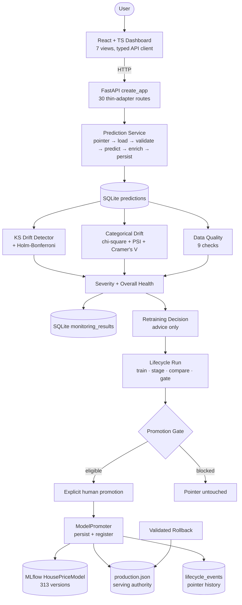

# AdaptiveAI — Complete Technical Documentation

> **Source of truth:** this document describes the repository as verified at the time of writing: production `RandomForestRegressor` v313 (`HousePriceModel` v313, schema v2), 313 registry versions, 1,067 collected tests. Every claim below was read from the implementation; anything unverifiable is marked **Not documented / Not verified**.

---

## 1. Executive Summary

AdaptiveAI is a local, reusable **ML/MLOps platform** that operates the complete supervised-model lifecycle under explicit, fail-closed governance: **serve → monitor → detect drift → assess data quality → recommend retraining → train candidates → evaluate → gate → explicitly promote → audit → roll back**. It is demonstrated through **Pune house-price valuation** — a schema-v2 prediction service enriched with locality benchmarks, empirical prediction ranges, and per-feature explanations — but every MLOps layer (use-case abstraction, monitoring, retraining lifecycle, promotion gates, registry, audit, demo isolation) is use-case-generic.

The project's defining engineering event is a **real, sanctioned schema migration**: the legacy production model (`LinearRegression` v311, schema v1) could not serve the current v2 contract and failed closed; instead of bypassing the promotion gate, the team extended the lifecycle with an explicit migration mode (incompatible-baseline detection, absolute validation, mandatory human confirmation) and promoted `RandomForestRegressor` (R² 0.9301) to `HousePriceModel` **v313** through the official path, with pointer history and audit intact.

The system serves a FastAPI backend (30 routes), a SQLite + MLflow persistence layer, and a React + TypeScript dashboard (7 views) including a Leaflet/OpenStreetMap Pune locality map and an isolated drift Scenario Simulator.

## 2. Problem Statement

Static ML prediction systems fail in production for well-understood reasons, each of which AdaptiveAI addresses:

| Problem | Consequence without governance | AdaptiveAI answer |
|---|---|---|
| Model degradation | Silent accuracy decay as distributions shift | KS + categorical drift monitoring with severity |
| Data drift | Stale models served confidently | Explicit drift detection (Holm–Bonferroni controlled) |
| Schema changes | Crashes or silent mis-serving | Schema compatibility gates + sanctioned migration mode |
| Unsafe deployment | Auto-retraining ships worse models | Strict R² improvement rule; eligible ≠ promoted |
| Lack of auditability | "Who changed production, and why?" unanswerable | Run ledger, pointer history, lifecycle events |
| Lack of explainability | Users cannot interrogate estimates | Linear-exact / baseline-substitution explanations |
| Data-quality incidents | Garbage in, confident predictions out | 9-check DQ service gating retraining and promotion |
| Demo contamination | Experiments pollute production KPIs | Demo Mode with source-isolated traffic |

## 3. Project Objectives

1. Serve Pune house-price valuations with benchmark context, ranges, and explanations (schema v2).
2. Detect numeric drift (KS), categorical drift (chi-square/PSI), and data-quality failures deterministically.
3. Retrain only on explicit demand; never auto-promote.
4. Promote only on measured R² improvement over production (ties/regressions block).
5. Fail closed on schema incompatibility; migrate only via an explicit confirmed path.
6. Record every lifecycle transition (runs, gates, promotions, rollbacks) for audit.
7. Keep demonstration traffic fully isolated from production.
8. Verify each property with automated tests using isolated state.

## 4. Scope

**Implemented:** house-price use case end to end; monitoring + DQ + severity; deterministic retraining advice; explicit retraining runs; 8-gate upgrades; 9-gate confirmed migrations; MLflow registry + pointer authority; validated rollback; audit events; 5-scenario simulator; React dashboard with Leaflet map; 1,067 collected tests.

**Deliberately excluded:** authentication/authorization, cloud deployment, Docker/CI-CD, background scheduling (the scheduler abstraction reports status and runs single explicit cycles only), additional use cases, live market-data feeds, browser-based E2E testing in this environment.

**Future scope:** new `BaseUseCase` implementations, recurring scheduler execution behind the existing gate, per-use-case monitoring configuration, real feeds, auth, cloud. These are **not** implemented.

## 5. System Overview

A prediction request flows: React form → typed HTTP client → FastAPI thin adapter → production pointer resolution → artifact load → v2 validation → pipeline prediction → valuation enrichment (benchmark, residual interval, metadata) → SQLite persistence → enriched JSON response. Independently, every persisted prediction feeds the monitoring window: data-quality checks + numeric/categorical drift → severity/health → persisted monitoring result → deterministic retraining recommendation. On explicit demand, a retraining run trains three candidates, stages the best, compares against production, gates, and — only on explicit promotion — persists, registers, publishes the pointer, and audits. Rollback restores any history-recorded pointer after validation. Demo traffic replays the same engines against isolated rows.

## 6. High-Level Architecture

### 6.1 Platform data flow

### 6.2 Frontend architecture

`App` → `AppProvider` (view state, currency, refresh tick) → `Shell` (`Sidebar`, `TopBar`, `WalkthroughBar`) → 7 page components. All server data flows through `api/client.ts`; shared UI primitives live in `components/ui.tsx`; the map is `components/LocalityMarketMap.tsx`. No ML logic, no direct DB/MLflow access, no background polling.

### 6.3 Backend architecture

`app/api/main.py` exposes `create_app(db_manager?)` (plus module-level `app = create_app()` for uvicorn). Routes are thin adapters over services (`monitoring_service`, `retraining_service`, `lifecycle`, `demo.service`, `model_promoter`); repositories (`PredictionRepository`, `MonitoringRepository`, `PromotionRepository`, lifecycle repositories) own all SQLite access; `MLEngine`/`MLflowTracker` own training/tracking.

### 6.4 ML architecture

Single shared training path (`use_cases/house_price/training.py`): load → validate → split → per-candidate `train_and_evaluate` via `MLEngine` → MLflow tracking → best-by-R² selection. Preprocessing (`preprocessing.py`), candidates (`HousePriceUseCase`), and metrics are defined once and reused by legacy training, selection, orchestration, and lifecycle.

### 6.5 MLOps lifecycle architecture

Monitoring (read-only over production rows) → decision (pure advice) → run (side effects limited to MLflow runs + staged file + ledger rows) → gate (pure judgment) → promotion (the **only** pointer-moving operation, re-gated and optionally human-confirmed) → audit. Rollback is a separate validated pointer move.

### 6.6 Demo architecture

`DemoService` + `scenarios` generate deterministic seeded rows stored with `source='demo'`; monitoring runs against a provider scoped to the session with a null persistence repository; retraining reuses the lifecycle with trigger `demo:<scenario>:<session>`; reset deletes only session rows. Production reads filter `source='production'`.

## 7. Technology Stack

| Layer | Technology (verified) |
|---|---|
| Language/runtime | Python 3.14 (venv), TypeScript ~6.0 |
| API | FastAPI, Pydantic, uvicorn, httpx |
| ML | scikit-learn (pipelines, ensembles), pandas, numpy, scipy, joblib |
| Tracking/registry | MLflow (file store, `HousePriceModel`) |
| Database | SQLite (stdlib `sqlite3`, 7 tables) |
| Config | YAML (`config/platform.yaml`), python-dotenv |
| Frontend | React 19, react-dom, Vite 8, Tailwind 3, Leaflet 1.9.4 + react-leaflet 5, OpenStreetMap tiles |
| Testing | pytest (1,041 unit + 26 integration collected), oxlint, tsc |
| Misc | PyYAML, requests |

`requirements.txt` lists unpinned dependencies (pytest, python-dotenv, pyyaml, pandas, numpy, scipy, scikit-learn, joblib, mlflow, fastapi, pydantic, uvicorn, requests, httpx).

## 8. Dataset and Domain

The reference dataset (`data/reference/house_price_reference.csv`, 8,500 rows) is **fully synthetic**, generated by `scripts/create_house_price_reference.py` with the config seed (42). It is calibrated against publicly available Pune locality asking-rate benchmarks — approximate anchors, **not** transaction records.

Feature table (schema v2, `DATA_SCHEMA_VERSION = 2`):

| Feature | Type | Role / validation |
|---|---|---|
| `area_sqft` | numeric float | > 0 |
| `bedrooms` | int 1–6 | ≥ 1, BHK-band checked |
| `bathrooms` | int 1–6 | ≥ 1, ≤ bedrooms + 2 |
| `parking` | int 0–3 | bounded |
| `property_age` | float ≥ 0 | depreciation driver |
| `floor_number` | int ≥ 0 | ≤ `total_floors` |
| `total_floors` | int ≥ 1 | building height |
| `location` | categorical | one of 12 localities |
| `furnishing_status` | categorical | Unfurnished / Semi-Furnished / Fully-Furnished |
| `property_type` | categorical | Apartment / Villa / Row House |
| `price` | target (INR) | > 0, never a feature |

12 localities with base-rate anchors: Kothrud 11,500; Aundh 11,000; Baner 10,500; Viman Nagar 10,000; Kharadi 9,500; Balewadi 9,000; Wakad 8,800; Hinjawadi 8,200; Punawale 7,800; Hadapsar 7,500; Ravet 7,200; Wagholi 6,800 (₹/sqft, ± variability bands per locality).

Validation (`validation.py`) enforces structure, nulls, duplicates, dtypes/finiteness, ranges, categorical membership, and cross-feature relationships. Schema v1 (legacy: `area/bedrooms/bathrooms/property_age/parking → house_price`) is recognized by DQ/monitoring for graceful handling but cannot be served.

## 9. Feature Engineering / Preprocessing

Exactly what `get_preprocessor()` builds — nothing more:

- Numeric (7 v2 features): `SimpleImputer(strategy='median')` → `StandardScaler`.
- Categorical (3 features): `SimpleImputer(strategy='most_frequent')` → `OneHotEncoder(handle_unknown='ignore')` (unseen localities/categories never crash inference).
- `ColumnTransformer` with `remainder='drop'` (the target never enters the matrix).

No manual feature crosses, no target encoding, no scaling of the target. The fitted preprocessor ships inside the persisted pipeline, so serving preprocessing is identical to training by construction.

## 10. Model Training

- **Candidates** (`HousePriceUseCase.get_model_candidates`): `LinearRegression(fit_intercept=True)`; `RandomForestRegressor(n_estimators=100, max_depth=None, random_state=42)`; `GradientBoostingRegressor(n_estimators=100, learning_rate=0.1, max_depth=3, random_state=42)`.
- **Split**: `train_test_split(test_size=0.20, random_state=<config seed 42>)` after validation.
- **Metrics**: MAE, RMSE, R² via `MLEngine.train_and_evaluate`, normalized to floats.
- **Tracking**: one MLflow run per candidate (params, metrics, pipeline artifact, lineage tags `training_stage/training_context/use_case/model_name`, `candidate_role` candidate/best). Tracking-only: no registry writes.
- **Selection**: highest R², first-max-wins (deterministic).
- **Current production** (canonical holdout, verified):

| Model | MAE (₹) | RMSE (₹) | R² |
|---|---|---|---|
| **RandomForestRegressor v313 (production)** | 10,89,272 | 15,04,268 | **0.9301** |
| GradientBoostingRegressor (candidate) | 10,82,055 | 15,04,746 | 0.9300 |
| LinearRegression (candidate) | 12,19,503 | 16,42,862 | 0.9166 |

## 11. Prediction Engine

`POST /predict/house-price` (Pydantic `HousePriceRequest`, 10 fields with range checks + cross-field rules `floor ≤ total`, `bathrooms ≤ bedrooms + 2`):

1. Resolve serving model via `production.json` (legacy filename only when no pointer exists; broken pointer → 503, never silent fallback).
2. Validate input frame (`predict_house_price`, dummy `price` for validator reuse) → `pipeline.predict`.
3. Persist to `predictions` with authoritative served name/version (or `None` on legacy path).
4. Enrich via `build_valuation`: `predicted_price_per_sqft = prediction / area`; `locality_benchmark_price = benchmark_rate × area` (+ `benchmark_difference`, `benchmark_difference_percent`); empirical residual interval (`prediction_lower/upper` from holdout Q05/Q95 residuals, lower floored at 0); serving metadata.

Response contract (15 fields): `prediction, predicted_price_per_sqft, locality_benchmark_price, benchmark_price_per_sqft, benchmark_difference, benchmark_difference_percent, prediction_lower, prediction_upper, model_name, model_version, schema_version (=2), prediction_id (real SQLite id), inferred_at, location, area_sqft`. Enrichment failures degrade to the stable Phase-1 shape instead of failing the request. Verified live: Wakad 3BHK/1200 sqft → HTTP 200, ₹1,18,95,711.28, interval ₹95,65,087–₹1,43,47,291, id #434.

## 12. Explainability

`POST /predict/house-price/explain` computes contributions from the **actually deployed pipeline** (no hardcoded values):

- `linear_exact`: exact additive decomposition `prediction = intercept + Σ contributions` for linear models.
- `baseline_substitution`: for tree models, per-feature marginal effect `predict(x) − predict(x with feature ← reference median/mode)`. These are **non-additive by design** (interacting features mean marginals don't sum to the prediction) and documented as such.
- Each contribution carries `direction`: `positive`/`negative`/`neutral`, where neutral = |contribution| within `NEUTRAL_TOLERANCE_FRACTION = 0.005` (0.5%) of |prediction|.

Verified live on the Wakad input: method `baseline_substitution`, 10 contributions, top drivers Living Area +₹19,29,823, Locality (Wakad) +₹9,26,051, Furnishing +₹4,28,860; model v313.

## 13. Pune Locality Context

- **Benchmarks** (`benchmarks.py` over `market_config.LOCALITY_RATES`): per-locality `benchmark_price_per_sqft` + calibration note; `compare_to_benchmark` derives predicted ₹/sqft, benchmark total, and differences. Served at `GET /predict/house-price/benchmarks[?location=]`.
- **Ranked comparison** (Predictions page): model estimate vs locality benchmark bars, difference chip, per-locality ranked list with the evaluated locality highlighted. Untouched by the map feature.
- **Geographic map** (`components/LocalityMarketMap.tsx`, Leaflet 1.9.4 + react-leaflet 5, OpenStreetMap tiles with attribution): 12 real locality-center markers (e.g. Hinjawadi [18.5917, 73.7380], Kothrud [18.5074, 73.8077], Wagholi [18.5787, 73.9837]); radius/opacity scale with API benchmark rates only; click syncs the prediction form; selected locality gets halo + permanent label; popups show name/₹/sqft/note; legend, dark tile/popup styling, 340px mobile / 440px desktop heights. Coordinates are visualization metadata — **not property-level GPS** (stated on screen).

## 14. Monitoring System

Data flow: `PredictionRepository` (production rows only) + reference CSV → `MonitoringService.run_check` / `run_health_check` → persisted `monitoring_results` → deterministic recommendation input.

- **Numeric drift** (`DriftDetector`): two-sample Kolmogorov–Smirnov per monitored feature. For samples $F_m, G_n$,
  $D = \sup_x |F_m(x) - G_n(x)|$.
  A feature is drifted when Holm–Bonferroni-adjusted $p < \alpha$ ($\alpha = 0.05$, `DEFAULT_MIN_PRODUCTION_ROWS = 30`; below the floor → `sufficient_data = false`, honestly `unknown`). Holm step-down controls family-wise error without independence assumptions.
- **Categorical drift** (`CategoricalDriftDetector`): chi-square homogeneity on the union of observed categories; expected counts < 5 (`MIN_EXPECTED_COUNT`) merge into `OTHER_RARE`; untestable → `insufficient`. Effect size **PSI**,
  $\mathrm{PSI} = \sum_i (a_i - e_i)\,\ln(a_i / e_i)$ (additive-smoothed, unmerged),
  with **Cramér's V** $\sqrt{\chi^2/n}$ (2×K table) as supplementary evidence. Holm–Bonferroni applies within the categorical family.
- **Severity** (`severity.py`): `healthy` (data sufficient, nothing drifted, DQ passes) / `warning` (small/moderate drift or DQ warnings) / `critical` (large effect: KS D ≥ 0.30 or PSI ≥ 0.25; or 3+ drifted features; or DQ fail) / `unknown` (insufficient data). `classify_overall_health` folds in DQ: critical > warning > healthy; unknown only when drift itself is unknown. Severity describes shift, never model quality.
- **Persistence/history/distributions**: every check persists (nullable model/version/severity/health/quality columns added non-destructively); `history` paginates; `distributions` returns shared-range histograms (20 bins) plus per-category counts/shares. Malformed stored rows are counted, never crash the path.

## 15. Data Quality System

`run_house_price_data_quality(rows)` classifies each stored row as v2 / legacy-v1 / malformed (counted, never raised on) and runs 9 checks:

| Check | Fails on | Warns on |
|---|---|---|
| `window` | — (empty → `unknown`) | — |
| `schema` | malformed / neither-schema rows | — |
| `legacy_schema` | — | legacy v1 rows (preserved, excluded from drift) |
| `missing_values` | null/NaN/'' in v2 rows | — |
| `duplicates` | — | repeated v2 rows (legitimate traffic) |
| `numeric_ranges` | area ≤ 0, bedrooms/bathrooms < 1, parking ∉ 0–3, age < 0, floor < 0, total < 1, non-finite | — |
| `categorical_values` | unknown location/furnishing/type | — |
| `relationships` | floor > total, bathrooms > bedrooms + 2 | — |
| `outliers` | — | area outside documented BHK band (review heuristic) |

Overall: any fail → `fail`; else any warn → `warn`; else `pass`; empty window → `unknown`. DQ `fail`/`unknown` blocks retraining advice and promotion gates; `warn` is advisory.

## 16. Retraining Decision Engine

`recommend_retraining(summary, production_model, production_version)` — pure advice, zero side effects:

- `MIN_WINDOW_ROWS = 30`: below the detector floor → blocked `insufficient-data`.
- DQ `fail` → blocked `data-quality-failed`; DQ `warn` → trigger note only; unknown DQ → blocked.
- `severity == 'critical'` → recommend; else drifted-feature count ≥ `ACTION_DRIFT_COUNT = 2` → recommend; single small drift → explicitly not recommended.
- Categorical drift surfaces as `categorical-drift:<feature>` triggers without changing the numeric production-trigger semantics consumed downstream.

## 17. Retraining Pipeline

`RetrainingLifecycleService.start_run` (via `POST /retrain/house-price/runs`; trigger label, `production_limit` window):

1. Load + validate + split training data (shared path); open a `started` run with dataset identity (`<name>#sha256:<10>`, rows), schema v2, split sizes, seed, feature schema, candidate configs, production-at-start.
2. `RetrainingService.retrain(promote=False)`: train/track all three candidates in MLflow, select best R².
3. Stage the winning pipeline to `.staging/<run_id>.joblib` (never the production path).
4. `_compare_against_production` on the canonical holdout: normal case → candidate/production metrics + documented deltas (`mae_delta`, `rmse_delta`, `r2_improvement`, reduction/improvement percents); incompatible production → `incompatible_baseline` record (§19); missing artifact → `no_production_model` semantics.
5. Evaluate the applicable gate, complete the run, audit `retraining_completed` (or `retraining_failed` with reason). **Runs never promote, never touch the pointer.**

## 18. Promotion Gate

Normal upgrades — `check_promotion_eligibility` (pure, no I/O):

| Gate | Meaning | Pass condition | On failure |
|---|---|---|---|
| `run_completed` | run finished training | status `completed` | block |
| `artifact_available` | staged file exists | file present | block |
| `artifact_loadable` | deserializes + predicts | loads | block |
| `schema_compatible` | serves current schema | trial prediction succeeds | block |
| `metrics_available` | MAE/RMSE/R² finite | all finite | block |
| `production_baseline` | baseline measurable | production metrics finite | fail closed ("initial deployment required") |
| `regression_tolerance` | strict improvement | R² gain > 0.0 (`REGRESSION_TOLERANCE_R2`; ties block) | block |
| `data_quality` | window health | `pass`/`warn` | `fail`/`unknown` block |

`eligible` requires all 8 — and eligibility still requires an explicit `promote` call. Migration mode (`check_migration_eligibility`, 9 checks) replaces the two relative checks with `production_baseline = PASS_WITH_INCOMPATIBLE_BASELINE` and `regression_tolerance = NOT_APPLICABLE_SCHEMA_MIGRATION`, adding `migration_validation` (R² > `MIGRATION_MIN_R2 = 0.0` absolute floor + candidate schema == current schema). No absolute threshold pre-existed; the floor reuses the documented tolerance constant and is reported as such.

## 19. Schema Migration

Case study — the v1 → v2 migration (verified end to end):

1. **Legacy state**: `LinearRegression` v311 expected v1 features; v2 requests failed closed (503, nothing persisted). The Predictions page honestly reported incompatibility.
2. **Correct failure**: lifecycle baseline comparison raised `columns are missing: {'area'}` instead of fabricating a comparison; the run recorded `failed`. A bypass (manual pointer edit, artifact copy, gate skip) would have destroyed auditability — all were refused by project rules.
3. **Sanctioned implementation** (existing services extended, no parallel pipeline): `_compare_against_production` trial-predicts production on the holdout — failure + working candidate → `incompatible_baseline` comparison with reason, expected-vs-current features, and schema versions; `start_run` completes with the staged v2 candidate; `promotion_check` evaluates the migration gate with the explicit *"Schema migration required…"* message; `promote(..., allow_migration=True)` re-gates, re-validates loadability/trial-predict/traceability, promotes via the new `ModelPromoter.promote_schema_migration` (same persist→register pattern, strict assessment validation), publishes via the existing `update_production_pointer`, records pointer history + `model_promoted`.
4. **Outcome**: run `rtr_e82b9a983bcd`, `RandomForestRegressor` (R² 0.9301), **`HousePriceModel` v313**, all 9 gates passing, DQ warn noted. Legacy v1 bytes preserved for schema-guarded rollback.
5. **Why not the normal gate**: with no measurable baseline, R² improvement is undefined — the normal gate correctly refuses; the migration gate substitutes absolute validation + human confirmation, which is strictly stronger than guessing a baseline.

## 20. Model Registry

MLflow file store (`mlruns/`): per-candidate runs (params, metrics, artifacts, lineage) plus `HousePriceModel` registered versions — **313 versions**, latest v313 → run `4ee9b805…`, status READY. Registry writes occur **only** at promotion (`register_model(run_id, HousePriceModel, 'model')`); the actual returned name/version propagate to the pointer (never fabricated). `GET /models/house-price/registry` additionally surfaces lifecycle candidates, pointer lineage, and promotion decisions. Partial-failure semantics are explicit: filesystem-persisted but registry-failed promotions raise with partial context and are never reported as success, with no destructive rollback of the previous artifact.

## 21. Rollback

`POST /retrain/house-price/rollback` (`pointer_history_id`): loads the history-recorded **previous** pointer, refuses no-ops (same model/version/run), verifies the target artifact exists, loads, and **trial-predicts on the current schema** — then atomically republishes, appends history, and audits `model_rollback`. Consequence (verified): rollback to incompatible v311 is **refused with the pointer untouched** (`columns are missing: {'area'}`), because serving it would re-break predictions. The mechanism (history entry 1: v311 → v313) remains available; the schema guard decides each target on its merits. Tested: unknown ids → 404/None; refusals leave hashes identical.

## 22. Audit System

Append-only `lifecycle_events` (plus legacy `promotion_history` and `production_pointer_history`):

| Event | When |
|---|---|
| `retraining_started` / `retraining_completed` / `retraining_failed` | run lifecycle (with reason/metrics) |
| `promotion_check` | every gate evaluation (eligible + checks) |
| `model_promoted` | pointer moved (prev/new versions) |
| `model_rollback` | pointer restored |
| `demo_session_created`, `demo_scenario_generated`, `demo_monitoring_run`, `demo_retraining_started`, `demo_session_reset` | demo flows (always distinguishable; a real demo promotion still records authoritative `model_promoted`) |

Verified live: `model_promoted` (RF v313, previous v311) and pointer-history id 1 with the migration reason.

## 23. Demo Mode / Scenario Simulator

Sessions ledger (`demo_sessions`: id, scenario, status active/completed/reset, counts, seed, params, monitoring snapshot): `POST /demo/.../sessions` → `generate` (deterministic `random.Random` rows, byte-identical for same inputs) → `monitor` (real Phase-4 summary + Phase-5 advice, unpersisted) → `retrain` (real lifecycle run, trigger `demo:<scenario>:<session>`, never promotes) → `reset` (deletes only that session's demo rows). Five scenarios: `healthy_baseline`, `area_shift` (2400–3000 sqft → numeric area drift), `locality_shift` (90% Kothrud → categorical drift), `config_shift` (villa/furnishing mix), `data_quality` (duplicates, floor/bathroom violations, BHK outliers). Demo predictions reuse the serving model when compatible, else a benchmark estimate (never consumed by drift). Counts < 30 honestly yield `insufficient_data`. Promotion from demo UI requires the same explicit endpoint plus a confirmed warning.

## 24. Frontend Architecture

State-driven views (`store.tsx`: `view`, currency, refresh tick) under `Shell` (`Sidebar` with live production label, `TopBar` with monitoring tone, `WalkthroughBar`): **Overview, Predictions, Monitoring, Retraining, Registry, Audit, ScenarioSimulator**. `api/client.ts` is the exclusive server boundary (typed, user-safe errors); `types.ts` mirrors backend contracts. Design system (`ui.tsx`: `SectionCard`, `StatusBadge`, `MetricCard`, `KeyVal`, `EmptyState`, `InfoPanel`, `PageHeader`) on the dark `aa-*` theme. Every page implements loading/error/empty states; the Predictions page degrades honestly (422 input hint, 503 incompatibility notice — now unreachable, 200 path verified). Map: `LocalityMarketMap` (Leaflet) + detail panel + legend + disclaimer, fed solely by `api.benchmarks()`.

## 25. API Reference

Base `http://127.0.0.1:8000` (docs at `/docs`). All POST bodies are JSON. Errors use HTTP semantics (422 validation, 404 unknown id, 503 model unavailable, 500 adapter failure).

| Method | Endpoint | Purpose | Request | Response / notes |
|---|---|---|---|---|
| GET | `/health` | liveness | — | `{"status": "healthy"}` |
| POST | `/predict/house-price` | predict + persist + enrich | 10 v2 fields | 15-field valuation (§11); 422 bad input; 503 incompatible/missing model |
| POST | `/predict/house-price/explain` | deployed-model explanation | same 10 fields | contributions + intercept + method + model/version |
| GET | `/predict/house-price/history` | prediction history | `limit`/`offset` | `{items, limit, offset}` newest-first |
| GET | `/predict/house-price/benchmarks` | locality benchmarks | optional `?location=` | 12 items + `schema_version` |
| POST | `/monitor/house-price` | run + persist drift check | — | legacy detector contract |
| GET | `/monitor/house-price/summary` | full health check + persist | `?limit=` | status/severity/health/DQ/drifted counts |
| GET | `/monitor/house-price/history` | monitoring history | `limit`/`offset` | persisted results |
| GET | `/monitor/house-price/distributions` | reference vs production histograms | `?limit=` | per-feature distributions |
| POST | `/monitor/house-price/retrain` | drift-triggered cycle | `{"promote": bool}` | orchestrator result (pipeline object omitted) |
| GET | `/monitor/house-price/retrain/history` | promotion history | `limit`/`offset` | recorded decisions |
| POST | `/monitor/house-price/deploy-initial` | explicit first deployment | — | deploy flow; no auto-promotion elsewhere |
| GET | `/monitor/house-price/retrain/status` | scheduler status | — | read-only |
| GET | `/retrain/house-price/decision` | retraining advice | `?limit=` | decision + monitoring subset |
| POST | `/retrain/house-price/runs` | start run | `{"production_limit", "trigger"}` | run record; never promotes |
| GET | `/retrain/house-price/runs` | list runs | `limit`/`offset` | newest-first |
| GET | `/retrain/house-price/runs/{run_id}` | run detail | — | metrics/comparison/gate; 404 unknown |
| POST | `/retrain/house-price/runs/{run_id}/promotion-check` | fresh gate + audit | `{"window_limit"}` | eligible/checks/comparison (+ `migration` block in migration mode) |
| POST | `/retrain/house-price/runs/{run_id}/promote` | explicit promotion | optional `{"allow_migration"}` (default false) | promoted outcome or blocked reason |
| POST | `/retrain/house-price/rollback` | validated rollback | `{"pointer_history_id"}` | restored production or refusal |
| GET | `/models/house-price/production` | production spec | — | model/version/run/sklearn/dataset/metrics(R²/MAE/RMSE)/features |
| GET | `/models/house-price/registry` | registry view | `?limit=` | production, runs, pointer history, versions, MLflow versions, total |
| GET | `/demo/house-price/scenarios` | scenario metadata | — | names/expectations |
| POST | `/demo/house-price/sessions` | create session | `{"scenario", "sample_count", "seed", "params"}` | session |
| GET | `/demo/house-price/sessions` | list sessions | `limit`/`offset` | sessions |
| GET | `/demo/house-price/sessions/{id}` | session detail | — | session + monitoring snapshot |
| POST | `/demo/house-price/sessions/{id}/generate` | generate rows | — | deterministic samples |
| POST | `/demo/house-price/sessions/{id}/monitor` | session health check | — | summary + advice, unpersisted |
| POST | `/demo/house-price/sessions/{id}/retrain` | session lifecycle run | `{"production_limit"}` | run record, never promotes |
| POST | `/demo/house-price/sessions/{id}/reset` | delete session rows | — | production untouched |

## 26. Database / Persistence

SQLite (`data/adaptive_ai.db`), accessed only via repositories; tests use temp databases. Tables:

- **`predictions`**: id, timestamp, use_case, model_name, model_version (nullable), `input_data` JSON, prediction, `source` (`production`/`demo`/NULL legacy), `demo_session_id` (nullable).
- **`monitoring_results`**: persisted checks incl. nullable model/version/severity/health/quality enrichment.
- **`promotion_history`**: legacy evaluator/promoter outcomes (decision, scores, reason).
- **`retraining_runs`**: run ledger (§17); JSON columns for schemas/metrics/comparison/gates.
- **`lifecycle_events`**: audit trail (§22).
- **`production_pointer_history`**: previous→new pointer snapshots + reason + run id.
- **`demo_sessions`**: session ledger (§23).

Migrations are additive (`ALTER TABLE`, nullable columns); legacy rows read back with null enrichment; nothing is ever rewritten or deleted except a session's own demo rows on reset.

## 27. Security / Safety / Production Controls

- Explicit promotion only; `promote=False` defaults everywhere; eligible ≠ promoted.
- Schema compatibility trial-predictions at serving, gating, promotion, and rollback — all fail closed.
- Corrupt/missing pointer → 503, never silent fallback to another model (legacy filename only when no pointer exists at all).
- Demo isolation via `source` filtering on every production read.
- Destructive/pointer-moving actions require explicit calls (migration additionally requires `allow_migration` + UI-confirmed warning in demo flows).
- Pointer carries full lineage (model, registry version, run id); artifacts are never deleted; registry responses propagate verbatim.
- **Not implemented**: authentication, authorization, encryption, multi-tenancy. The safety model is single-operator local governance, not access control.

## 28. Testing Strategy

- **Unit** (1,041 collected): per-module suites — validation/split/training/selection, predict/valuation/benchmarks/explain, persistence/pointer/registry, KS/categorical/PSI/severity/DQ/trigger/service, retraining service/evaluator/decision/promoter/gates, lifecycle runs/gates/promote/rollback, migration A–J + assessment + SHA guards, API contract suites (stubbed services), demo scenarios/service/API/safety, scheduler/orchestrator, config/paths.
- **Integration** (26 collected, 2 files): `test_house_price_end_to_end`, `test_production_deploy_end_to_end` against isolated temp DBs/models/MLflow.
- **Safety style**: hash comparisons of pointer/artifact before/after blocked operations; temp-state fixtures; live-state canary guards asserting the sanctioned production pointer.
- **Verified runs (this environment)**: migration 16/16; API/valuation/serving/schema 73/73; lifecycle/promoter/decision/repository/service 87/87 — 0 failures. Full 1,067 collected; see §29 on full-suite status.
- **Integration**: 25/26 green in the latest run; the single failure is environmental (`WinError 112` — disk full during an MLflow artifact write in `test_deploy_initial_endpoint_end_to_end`), not a code failure.
- **Frontend**: `tsc` + vite build clean; oxlint 0 errors (pre-existing warnings only). No browser E2E in this environment.

## 29. Verification Evidence

| Item | Verified value |
|---|---|
| Production model | RandomForestRegressor v313 (`HousePriceModel` v313, READY, run `4ee9b8…`) |
| Serving schema | v2 (10 features) |
| Holdout metrics | R² 0.9301, MAE ₹10,89,272, RMSE ₹15,04,268 |
| Wakad prediction | HTTP 200, ₹1,18,95,711.28, interval ₹95.65L–₹1.43Cr, schema 2, id #434 |
| Explanation | HTTP 200, `baseline_substitution`, 10 contributions |
| Monitoring DQ (live window) | `warn` (advisory, non-blocking) |
| Migration run `rtr_e82b9a…` | completed, 9/9 gates pass, explicitly promoted |
| Registry | 313 versions; v313 → candidate run |
| Audit | `model_promoted` (311→313); pointer history id 1 with migration reason |
| Rollback guard | v311 target refused (schema), pointer untouched; mechanism available |
| Integration | 25/26 (1 environmental disk-space failure, §28) |
| Demo | 5 scenarios; isolation by `source`; reset semantics tested |
| Frontend build/lint | clean / 0 errors |
| Backend tests | targeted suites green (see §28); full-suite collection 1,067 |

## 30. Known Limitations

- OSM tiles need network; map degrades offline (app otherwise local).
- Markers are locality centers, not property locations.
- Benchmarks/dataset are synthetic calibration anchors, not live feeds.
- Single use case, single operator, no auth; scheduler runs explicit cycles only.
- Categorical drift loses power on tiny windows (bucket merging); trigger consumes numeric result.
- Migrating over a same-name artifact overwrites that file (pre-existing promoter limitation; legacy bytes survive here because the winner was a different model).
- Full-suite green run not executed in this session beyond the verified subsets (collection: 1,067); UI verified via contracts + build, not a live browser.
- Local MLflow file-store growth (~2.9 GB at last check): a full disk fails artifact writes — observed once as an environmental integration failure. Registry pruning is future scope.

## 31. Future Scope

Clearly **not implemented**: additional use cases, scheduled recurring retraining (gate retained), per-use-case monitoring config, live market feeds, auth/cloud/CI-CD, browser E2E, richer model families. The architecture anticipates the first three without rewrites (`BaseUseCase`, scheduler interface, detector contracts).

## 32. Innovation

The novelty is systems-level, not algorithmic: a fully governed adaptive loop where (a) drift + DQ + severity produce deterministic advice, (b) retraining is explicit and staged, (c) promotion is gated on measured improvement with mandatory human action, (d) schema incompatibility is a first-class, safely migratable state rather than a crash or a bypass, (e) every transition is auditable and reversible, and (f) drift can be rehearsed in isolation. Explainability + locality market context + geographic visualization make the same governance legible to non-ML stakeholders. No research novelty is claimed for the statistical components (KS, chi-square, PSI, Holm–Bonferroni are standard).

## 33. Demo Walkthrough

1. Overview: show production card (RF v313, R² 0.9301). 2. Predictions: run the Wakad 3BHK preset; point out estimate vs benchmark, interval, explanation. 3. Map: click localities, show selection sync + popups. 4. Monitoring: run health check; explain severity/DQ. 5. Simulator: create `area_shift` session, generate, monitor (drift), note production history unchanged. 6. Retraining: show decision advice, start a run, show gate. 7. Registry/Audit: pointer lineage, `model_promoted` event, migration story. 8. Rollback: show history entry; explain the v311 schema guard (do not execute live unless intended).

## 34. Viva Preparation

1. *Why not auto-promote on better R²?* — Measured improvement still needs human accountability; eligible ≠ promoted by design.
2. *Why did the v311 run record `failed`?* — Production couldn't predict on v2 holdout; failing honestly beats inventing a comparison.
3. *Why not just delete v311?* — Audit continuity + schema-guarded rollback require preserving history and bytes.
4. *What does `allow_migration` add?* — Explicit human confirmation, required in code, default-deny.
5. *Why R² for selection?* — Project convention for regression; documented, deterministic, first-max-wins.
6. *Why Holm–Bonferroni?* — Family-wise error control across 7 features without independence assumptions.
7. *Why not KS for categories?* — KS needs ordered continuous data; chi-square tests homogeneity correctly.
8. *What is PSI 0.25?* — Conventional large-shift band; severity threshold, not quality score.
9. *Why merge rare categories?* — Chi-square validity (expected ≥ 5); else `insufficient`, never a false claim.
10. *Empty monitoring window?* — `unknown`, blocks advice/gates.
11. *Legacy rows in DQ?* — Warn, preserve, exclude from drift; never delete.
12. *Duplicates fail or warn?* — Warn: repeats can be legitimate traffic.
13. *Tie on R²?* — Blocked (strict `>`); promotion must mean measured improvement.
14. *Migration floor R² > 0?* — Must beat the training mean; derived from the documented tolerance constant, explicitly reported.
15. *Candidate artifact vs registry?* — Staged file (`.staging/`) then registered version only at promotion.
16. *What moves the pointer?* — Only `RetrainingLifecycleService.promote` via `update_production_pointer`.
17. *Partial promotion failure?* — Raised with context, never reported as success; no destructive rollback.
18. *Rollback to v311 now?* — Refused by schema guard; pointer untouched.
19. *Demo vs production separation?* — `source`/`demo_session_id` filtering on every production read; null-repo monitoring.
20. *Deterministic demo?* — `random.Random(seed)` only; same inputs → byte-identical rows.
21. *linear_exact vs baseline_substitution?* — Exact additive for linear; marginal (non-additive) for trees.
22. *Neutral direction?* — |contribution| within 0.5% of |prediction|.
23. *Residual interval coverage?* — 90% of holdout residuals by construction; not a confidence level.
24. *Benchmark vs prediction?* — Benchmark is calibration context (rate × area), never a prediction.
25. *Map markers property locations?* — No: locality centers, visualization metadata.
26. *Why scrollWheelZoom off?* — Avoid trapping page scroll; dragging/zoom controls remain.
27. *Why 30-row floors?* — Detector validity; below it, honest `unknown`.
28. *Broad drift = 3?* — Project convention for cross-feature spread triggering criticality.
29. *What is `production.json`?* — Sole serving authority: model + registry version + run id.
30. *Biggest limitation?* — Single use case, local single-operator deployment; full-suite/browser verification limits noted honestly.

## 35. Conclusion

AdaptiveAI demonstrates that the hard part of production ML is governance, not modeling: every prediction is traceable to a versioned artifact and run; every monitoring claim is statistical and corrected; every training run is staged and gated; every production change is explicit, confirmed, audited, and reversible — including across a breaking schema change, which the system survived without a single bypass. The codebase, tests, and this document agree on the current state: **RandomForestRegressor v313 serving schema v2**, with the v311 legacy preserved, guarded, and recorded.

