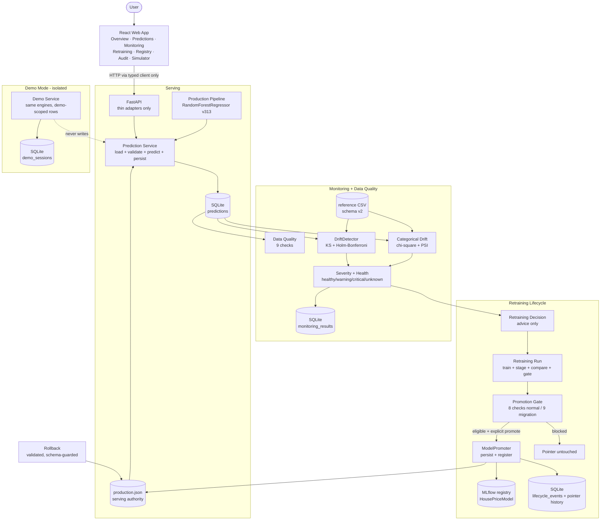
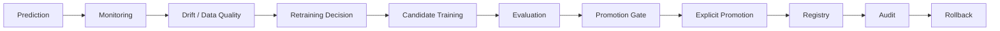

# AdaptiveAI

AdaptiveAI is an **adaptive ML/MLOps platform** that operates the full supervised-model lifecycle — serve, monitor, detect drift, retrain, gate, promote, audit, and roll back — under explicit, fail-closed governance. It is **demonstrated through Pune house-price valuation** (prediction + locality benchmarks + explanations), but the architecture (use cases, monitoring, retraining lifecycle, promotion gates, registry, audit) is use-case-generic, not a single house-price model.

**Current production (verified): `RandomForestRegressor` v313 (`HousePriceModel` v313), schema v2, holdout R² 0.9301** — deployed via an explicit, human-confirmed schema migration from the legacy v1 model (see [Schema Migration](#schema-migration)).

## Key Capabilities

- Pune-aware house-price prediction (schema v2, 10 features → `price` in INR)
- Locality benchmark context (12 Pune localities, calibration-anchored ₹/sqft) + benchmark difference
- Empirical prediction range (holdout residual interval, no confidence claims)
- Explainability (`linear_exact` for linear models, `baseline_substitution` for tree models)
- Data-quality validation (9 checks, pass/warn/fail/unknown)
- Numeric drift detection (two-sample KS test + Holm–Bonferroni)
- Categorical drift detection (chi-square homogeneity + PSI + Cramér's V)
- Monitoring severity (`healthy`/`warning`/`critical`/`unknown`) and overall health
- Retraining decisions (deterministic recommend/block rules)
- Candidate model evaluation (candidate vs production on the same split, R² rule)
- Promotion gates (8-gate normal path; 9-gate absolute migration path)
- Schema compatibility enforcement (incompatible models fail closed, never silently served)
- Controlled schema migration (explicit human confirmation, absolute validation)
- Model registry (MLflow `HousePriceModel` versions; **313 versions**)
- Audit trail (`lifecycle_events`, promotion history, pointer history)
- Rollback protection (validated, schema-guarded, no-op refusal)
- Isolated Demo Mode / Scenario Simulator (5 scenarios, zero production pollution)
- Pune geographic locality map (Leaflet + OpenStreetMap, 12 locality centers)

## Architecture



Demo Mode reuses the monitoring and lifecycle engines verbatim but scopes all reads/writes to `source='demo'` rows, so production traffic, KPIs, and history stay clean.

## ML Pipeline

- **Dataset**: fully synthetic, 8,500 rows (`scripts/create_house_price_reference.py`, seed 42), calibrated against public Pune locality asking-rate benchmarks. Not transaction data.
- **Schema v2** (10 features → `price`): `area_sqft, bedrooms, bathrooms, parking, property_age, floor_number, total_floors` (numeric) + `location, furnishing_status, property_type` (categorical). 12 localities, each with a base ₹/sqft anchor (see table below).
- **Preprocessing**: median impute + standard scale (numeric); most-frequent impute + one-hot (`handle_unknown="ignore"`) for categoricals.
- **Models evaluated**: `LinearRegression`, `RandomForestRegressor` (100 trees), `GradientBoostingRegressor` (100 estimators, lr 0.1, depth 3). Shared path (`training.py`), 80/20 split, seed 42, metrics MAE/RMSE/R², best = highest R².
- **Current production**: `RandomForestRegressor` v313 — MAE 10,89,272 · RMSE 15,04,268 · **R² 0.9301** (canonical holdout).

Locality calibration anchors (₹/sqft):

| Locality | Base ₹/sqft | Locality | Base ₹/sqft |
|---|---|---|---|
| Kothrud | 11,500 | Aundh | 11,000 |
| Baner | 10,500 | Viman Nagar | 10,000 |
| Kharadi | 9,500 | Balewadi | 9,000 |
| Wakad | 8,800 | Hinjawadi | 8,200 |
| Punawale | 7,800 | Hadapsar | 7,500 |
| Ravet | 7,200 | Wagholi | 6,800 |

## MLOps Lifecycle



Prediction → monitoring window → KS/categorical drift + 9 DQ checks → severity/health → deterministic retraining advice → explicit run (train 3 candidates, stage best, compare vs production) → 8-gate check → explicit gated promotion (pointer moves only here) → registry version → audit events → validated rollback available throughout.

## Monitoring

- **Numeric drift**: two-sample KS test per feature, `p_adj < α` (α = 0.05) after **Holm–Bonferroni** step-down; minimum 30 production rows or `insufficient_data`.
- **Categorical drift**: chi-square homogeneity on union categories; rare buckets (expected < 5) merge into `OTHER_RARE`; untestable → `insufficient`. Effect size **PSI** (smoothed), **Cramér's V** supplementary.
- **Severity**: `healthy` / `warning` / `critical` / `unknown` — critical on large effects (KS D ≥ 0.30, PSI ≥ 0.25), 3+ drifted features, or failed DQ. Describes shift, never model quality.
- **Data quality**: `schema, legacy_schema, missing_values, duplicates, numeric_ranges, categorical_values, relationships, outliers` (+ `window` for empty) → `pass`/`warn`/`fail`/`unknown`. Legacy v1 rows are preserved and excluded from drift, never deleted.

## Model Lifecycle

- **Retraining runs** (`retraining_runs`): identity, trigger, dataset hash/rows, schema, split, seed, candidates, production-at-start, best model/metrics/MLflow run, staged artifact, comparison, gate, promotion outcome. Failures recorded with reason; runs never promote.
- **Promotion gates**: 8 checks (run completed, artifact available/loadable, schema compatible, metrics finite, baseline measurable, R² improvement > 0.0, DQ not failed). Eligible ≠ promoted.
- **Explicit promotion**: re-gates, persists + registers via `ModelPromoter`, atomically publishes `production.json`, records pointer history + `model_promoted`. Any failure leaves the pointer untouched.
- **Rollback**: restores a history-recorded pointer after artifact + schema validation; refuses no-ops and unloadable/incompatible targets.

## Schema Migration

Real v1 → v2 case study (the project's key engineering story):

- **Legacy**: `LinearRegression` v311 expected v1 features (`area, bedrooms, …`) and raised `columns are missing: {'area'}` on v2 inputs. The prediction API failed closed (503) instead of mis-serving.
- **Correct failure**: the lifecycle's baseline comparison raised the same incompatibility instead of inventing a comparison — a failed run, not a silent pass.
- **Sanctioned path** (no bypass): incompatible baselines are recorded as `incompatible_baseline` (never a regression comparison); promotion uses a 9-gate **absolute** validation (artifact, schema-v2 trial prediction, finite metrics, R² > 0.0 floor derived from the documented tolerance constant, DQ) plus **mandatory human confirmation** (`allow_migration=True`). Normal upgrades still use the relative 8-gate path unchanged.
- **Outcome**: `RandomForestRegressor` (R² 0.9301) promoted to **`HousePriceModel` v313** with pointer history + audit; legacy bytes preserved for schema-guarded rollback.

## Demo Mode

Five deterministic scenarios (seeded): `healthy_baseline` (in-distribution), `area_shift` (large-area concentration → numeric drift), `locality_shift` (Kothrud concentration → categorical drift), `config_shift` (villa/furnishing mix shift), `data_quality` (duplicates, floor/bathroom violations, BHK outliers). Demo rows carry `source='demo'` + `demo_session_id`; monitoring/retraining reuse production engines scoped to the session; reset deletes only session rows. Production traffic is never polluted.

## Pune Locality Map

Leaflet 1.9.4 + react-leaflet 5 with OpenStreetMap tiles (attributed) in `LocalityMarketMap.tsx`: 12 real locality-center markers, radius/opacity scaled by API benchmark rate, click-to-select synced with the prediction form, popups (name, ₹/sqft, calibration note), permanent label on the selected locality, legend, and dark-theme tile/popup styling. Markers are locality centers, **not** property-level GPS data.

## Project Structure

```text
adaptive-ai/
  app/
    api/            # FastAPI thin adapters (create_app, 30 routes)
    core/           # config, logging, exceptions
    database/       # DatabaseManager + repositories (7 tables)
    demo/           # Scenario Simulator (scenarios, service)
    engine/         # MLEngine, MLflowTracker
    monitoring/     # provider, KS detector, categorical drift, severity, DQ, trigger, service
    retraining/     # service, evaluator, decision, promotion gate, promoter, lifecycle
    scheduler/      # RetrainingScheduler, DriftRetrainingOrchestrator
    use_cases/house_price/  # market_config, validation, split, preprocessing,
                            # training, predict, valuation, benchmarks, explain,
                            # persistence, production_info
  config/platform.yaml      # seed 42, DB path, scheduler defaults
  frontend/src/     # api/client, components (incl. LocalityMarketMap), pages ×7, state, types
  data/reference/   # versioned reference CSV (schema v2)
  models/house_price/       # production.json + served artifacts
  mlruns/           # local MLflow store (313 registry versions)
  scripts/          # reference-data generation
  tests/unit + tests/integration
```

## API Overview

| Group | Endpoints |
|---|---|
| Prediction | `POST /predict/house-price`, `POST /predict/house-price/explain`, `GET /predict/house-price/history`, `GET /predict/house-price/benchmarks` |
| Monitoring | `POST /monitor/house-price`, `GET /monitor/house-price/summary`, `GET /monitor/house-price/history`, `GET /monitor/house-price/distributions`, `POST /monitor/house-price/retrain`, `GET /monitor/house-price/retrain/history`, `POST /monitor/house-price/deploy-initial`, `GET /monitor/house-price/retrain/status` |
| Retraining | `GET /retrain/house-price/decision`, `POST/GET /retrain/house-price/runs`, `GET /retrain/house-price/runs/{id}`, `POST /retrain/house-price/runs/{id}/promotion-check`, `POST /retrain/house-price/runs/{id}/promote`, `POST /retrain/house-price/rollback` |
| Models/Registry | `GET /models/house-price/production`, `GET /models/house-price/registry`, `GET /health` |
| Demo | `GET /demo/house-price/scenarios`, `POST/GET /demo/house-price/sessions`, `GET /demo/house-price/sessions/{id}`, `POST …/{id}/generate`, `POST …/{id}/monitor`, `POST …/{id}/retrain`, `POST …/{id}/reset` |

## Testing

- **Collected**: 1,067 tests (1,041 unit + 26 integration across 2 end-to-end files).
- **Latest verified runs (this environment)**: schema-migration suite 16/16; API/valuation/serving/schema suites 73/73; lifecycle/promoter/decision/repository/service suites 87/87; integration 25/26 — all green except one environmental failure (`WinError 112`, disk full during an MLflow artifact write;0 code failures).
- **Verified live behavior**: Wakad prediction HTTP 200 (₹1,18,95,711.28, schema v2, id #434), explanation HTTP 200 (10 contributions), serving info v313, migration promotion + audit + pointer history, schema-guarded rollback refusal logic.
- **Frontend**: `npm run build` clean (tsc + vite); `npm run lint` (oxlint) with 0 errors (pre-existing warnings only).
- No live browser testing was performed in this environment; UI validation is via contract tests + build.

## Running Locally

Backend (Windows PowerShell, from `adaptive-ai/`):

```powershell
python -m venv .venv
.\.venv\Scripts\Activate.ps1
pip install -r requirements.txt
uvicorn app.api.main:app --host 127.0.0.1 --port 8000
```

Frontend (second terminal, from `adaptive-ai/frontend/`):

```powershell
npm install
npm run dev      # http://127.0.0.1:5173
npm run build    # production bundle (tsc + vite)
npm run lint     # oxlint
```

Tests (from `adaptive-ai/`):

```powershell
python -m pytest tests/unit -q
python -m pytest tests/integration -q
```

API docs: `http://127.0.0.1:8000/docs`.

## Screenshots

> Placeholder — capture from a running instance; do not commit fabricated images.
>
> - `docs/screenshots/overview.png` — Overview
> - `docs/screenshots/predictions.png` — Predictions
> - `docs/screenshots/pune-map.png` — Pune Map
> - `docs/screenshots/monitoring.png` — Monitoring
> - `docs/screenshots/retraining.png` — Retraining
> - `docs/screenshots/registry.png` — Registry
> - `docs/screenshots/simulator.png` — Scenario Simulator
> - `docs/screenshots/audit.png` — Audit

## Limitations

- OpenStreetMap tiles require network access; offline use degrades the map (rest of the app is local).
- Map markers are locality centers, not property locations.
- Benchmarks are calibration/reference anchors, not live transaction feeds; the dataset is fully synthetic.
- Single use case (House Price); single-user local deployment — no auth, no cloud, no CI/CD, no background scheduling (explicit cycles only).
- Full-suite green status above reflects the verified subsets + collection; see Testing.
- Local MLflow file store grows with every tracked run and registry version (~2.9 GB at last check); monitor disk space — a full disk fails artifact writes (observed once as `WinError 112` in an integration run).

## Future Scope (not implemented)

- Additional `BaseUseCase` implementations (no engine rewrite needed)
- Recurring execution behind the existing scheduler interface (explicit gate retained)
- Per-use-case monitoring configuration
- Real market-data feeds, authentication, cloud deployment

Earlier iterations used Streamlit; the current frontend is React + TypeScript. Full technical reference: [PROJECT_DOCUMENTATION.md](PROJECT_DOCUMENTATION.md).
